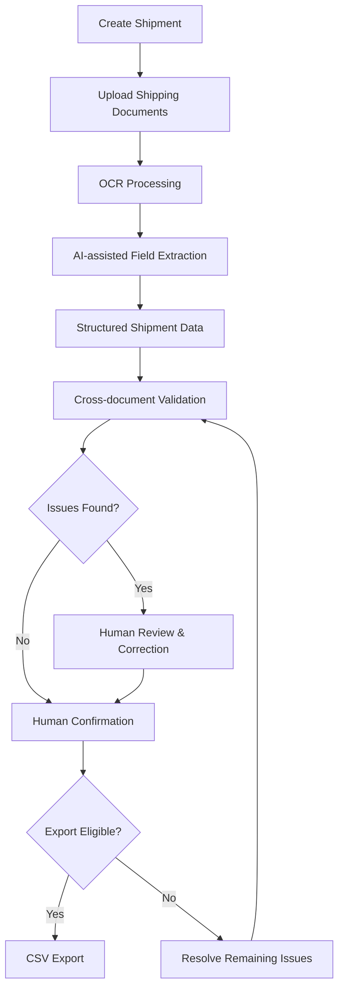
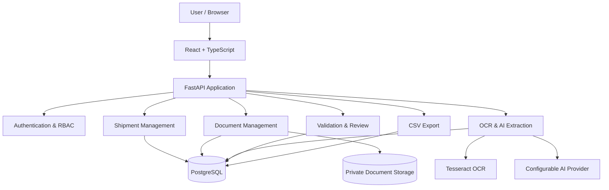

# ShipmentIQ

### AI-powered document extraction and cross-verification for global trade

ShipmentIQ helps customs brokerage teams turn shipping documents into structured, reviewable shipment data. Upload commercial invoices, packing lists, and bills of lading to extract key fields, compare information across documents, review discrepancies, and prepare eligible shipments for CSV export.

> **Upload → Extract → Compare → Review → Export**

<p align="center">
  <a href="https://github.com/Manjunath-G-K/isocode-engineering-challenge">
    
  </a>
  
  
  
  
</p>

---

## The problem

Import shipments involve multiple documents with overlapping information. Teams often need to manually inspect invoices, packing lists, and bills of lading to verify shipment details.

Differences in package quantities, weights, or other shipment data can require additional investigation. Manual verification takes time and makes it harder to keep a reliable record of corrections and approvals.

## The solution

ShipmentIQ brings document processing and verification into one workspace. It extracts structured fields, shows confidence and source-page references where available, and flags inconsistencies for human review.

AI-generated results are not treated as verified business data: users review and correct extracted values before export.

## How it works



1. **Create a shipment** — Record shipment references, origin countries, importers, suppliers, and descriptions.
2. **Upload documents** — Attach PDF or image-based shipping documents to a shipment.
3. **Extract information** — OCR and a configurable extraction provider identify structured fields.
4. **Compare documents** — Deterministic validation rules identify inconsistencies, missing values, and unresolved comparisons.
5. **Review and correct** — Authorized users confirm, reject, or correct extracted values. Corrections are recorded in the revision history.
6. **Export eligible data** — The backend checks review and validation conditions before generating a CSV.

### Example discrepancy

| Document | Gross weight |
|---|---:|
| Commercial invoice | 3,120 kg |
| Packing list | 3,165 kg |
| Difference | **45 kg** |

ShipmentIQ flags the difference for human review instead of automatically approving the shipment.

## Extracted information

Depending on the documents and extraction results, ShipmentIQ can capture:

- Invoice and document references
- Importer and supplier details
- Product descriptions and line items
- Quantities
- Gross and net weights
- Package counts
- Currency and monetary values
- HSN codes, when available

Extracted values can include confidence information and source-page references.

## Key capabilities

| Capability | Description |
|---|---|
| Shipment management | Create, list, view, and update shipments |
| Document uploads | Support for PDF, JPG, and PNG |
| OCR | Local Tesseract-based processing |
| AI-assisted extraction | Configurable extraction provider |
| Structured data | Validated schemas and field-level confidence |
| Provenance | Source-page references where available |
| Validation | Deterministic business rules |
| Human review | Correction, confirmation, and rejection |
| Audit history | Append-only field revision records |
| Access control | Role-based authorization |
| Reporting | Manager-level accuracy reports |
| CSV export | Backend-controlled export eligibility |

## Architecture

ShipmentIQ is built as a modular monolith, keeping the application straightforward to develop, test, and deploy without unnecessary distributed infrastructure.



### Design decisions

- **Modular monolith:** Keeps the system simpler to develop and operate.
- **PostgreSQL:** Stores relational shipment, document, extraction, and review data.
- **Private document storage:** Separates document files from application metadata.
- **Provider-neutral extraction:** Keeps the AI integration replaceable.
- **Deterministic validation:** Keeps business rules separate from probabilistic extraction.
- **Human-in-the-loop review:** Prevents uncertain AI output from being treated as verified data.

## Technology stack

| Layer | Technologies |
|---|---|
| Frontend | React, TypeScript, Vite |
| Backend | Python, FastAPI, Pydantic |
| Database | PostgreSQL |
| ORM and migrations | SQLAlchemy, Alembic |
| OCR | Tesseract |
| AI integration | Configurable OpenAI-compatible provider |
| Authentication | JWT, HttpOnly cookies, Argon2id |
| Authorization | Role-based access control |
| Storage | Private local filesystem |
| Testing | Pytest, frontend tests |
| Infrastructure | Docker Compose |

## Security and reliability

The application includes:

- Argon2id password hashing
- JWT-based authentication using HttpOnly cookies
- Role-based and shipment-level authorization
- CSRF protection for authenticated state-changing requests
- Private document storage with generated filenames
- File validation and path traversal protections
- Pydantic input validation
- Revision history for human corrections
- Backend-enforced export eligibility
- Database migrations and integration tests

**Production note:** A production deployment still requires additional operational controls, including rate limiting, malware scanning, production-grade object storage, and stronger token lifecycle management.

## Project structure

```text
isocode-engineering-challenge/
├── backend/
│   ├── app/
│   │   ├── api/
│   │   ├── core/
│   │   ├── models/
│   │   ├── schemas/
│   │   ├── services/
│   │   └── scripts/
│   ├── tests/
│   └── README.md
├── frontend/
│   ├── src/
│   └── README.md
├── docs/
│   ├── TDD.md
│   ├── architecture.md
│   └── requirements-analysis.md
├── output/
│   └── pdf/
├── deployment.md
├── docker-compose.yml
└── README.md
```

## Run locally

### Prerequisites

- Python 3.12 or later
- Node.js and npm
- Docker Desktop
- Git

### 1. Clone the repository

```bash
git clone https://github.com/Manjunath-G-K/isocode-engineering-challenge.git
cd isocode-engineering-challenge
```

### 2. Start PostgreSQL

```bash
docker compose up -d postgres
```

### 3. Start the backend

In a terminal:

```powershell
cd backend
.\.venv\Scripts\Activate.ps1
uvicorn app.main:app --reload
```

### 4. Start the frontend

In another terminal:

```bash
cd frontend
npm install
npm run dev
```

### 5. Open the application

| Service | URL |
|---|---|
| Frontend | http://localhost:5173 |
| Backend API | http://127.0.0.1:8000 |
| API documentation | http://127.0.0.1:8000/docs |
| Health check | http://127.0.0.1:8000/api/v1/health |

For database configuration, migrations, environment variables, and demo-user setup, see [deployment.md](deployment.md).

## Testing

Run backend tests:

```bash
cd backend
pytest
```

Run frontend tests:

```bash
cd frontend
npm test
```

Build the frontend:

```bash
cd frontend
npm run build
```

See [docs/TDD.md](docs/TDD.md) for the test strategy and implementation notes.

## Scope and limitations

ShipmentIQ focuses on document extraction, cross-document verification, and human review. It does **not** currently provide:

- Direct customs portal filing
- Automatic customs clearance
- Duty or tax calculations
- Automatic HSN classification
- A verified client-specific CSV filing template
- Autonomous shipment approval

AI extraction is not a substitute for human verification. Missing, uncertain, or inconsistent values require review. The CSV layout is provisional because a client-specific filing template was not supplied.

## Future improvements

Potential next steps include:

- Production object storage integration
- Document malware scanning
- Extraction evaluation using labelled datasets
- Configurable client-specific export templates
- Improved document comparison and review analytics
- End-to-end browser automation tests
- Production deployment and operational monitoring

## Engineering challenge submission

Built independently for the Isocode Labs Software Engineering Intern take-home assignment.

- **Repository:** [isocode-engineering-challenge](https://github.com/Manjunath-G-K/isocode-engineering-challenge)
- **Technical Design Document:** [docs/TDD.md](docs/TDD.md)
- **Deployment Guide:** [deployment.md](deployment.md)

---

<p align="center">
  <strong>ShipmentIQ</strong><br>
  <sub>Extract intelligently. Verify carefully. Export confidently.</sub>
</p>
