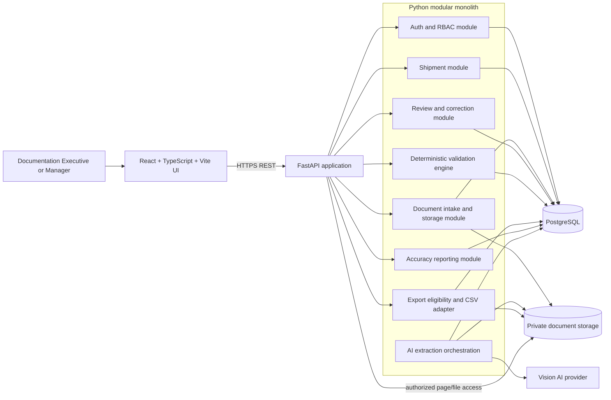
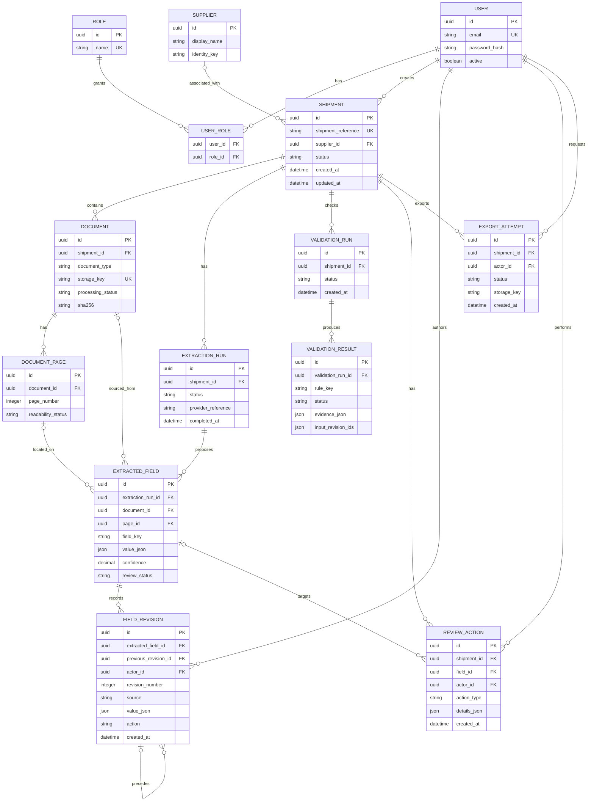

# Architecture Design: Customs Broker Import Shipment Cross-Check Tool

## Design status and labels

This document is an architecture proposal for the take-home implementation. It does not change `docs/requirements-analysis.md` or add client requirements.

- **Confirmed** — stated in the client brief, requirements analysis, or engineering guidelines.
- **Proposed** — an implementation decision made to satisfy confirmed requirements.
- **Assumption** — a temporary choice needed to make the design concrete; it must be labelled in implementation documentation.
- **Unresolved** — supplied information is insufficient to make the decision safely.

## 1. Architecture overview and rationale

### Proposed architecture

Use a Python/FastAPI modular monolith with a React/Vite frontend, PostgreSQL, private document storage, and a provider-neutral vision-AI adapter. For the seven-day MVP, extraction is invoked synchronously through the FastAPI application with an explicit timeout and truthful failure state. A same-codebase database-backed worker is an optional follow-on only if the selected provider cannot complete within the request budget; it is not part of the baseline deployment.

The main modules are:

- authentication and authorization;
- shipment management;
- document intake and storage;
- AI extraction;
- deterministic cross-document validation;
- human review and correction history;
- shipment/review state management;
- CSV export;
- accuracy reporting; and
- audit/error handling.

### Rationale

**Proposed:** A modular monolith is appropriate for one developer and the approximately six-to-eight-screen core build. It keeps transactions, authorization, extraction results, validation state, corrections, and export eligibility close together. Synchronous extraction avoids adding a queue/worker failure mode before the provider’s actual latency is known. The design avoids the operational cost of service discovery, distributed tracing, independent deployments, Kafka, Kubernetes, or Redis, none of which is required by the brief.

**Confirmed business boundary:** The system prepares verified structured shipment data and a CSV for the filing software's Excel import layout. It does not replace that software, file on a customs portal, classify HSN codes, calculate duty, or provide an importer tracking portal.

**Proposed processing boundary:** AI extraction is isolated behind an adapter and produces proposed field values. A separate deterministic validation module consumes reviewed/current values. The AI layer cannot set an approval or export-eligible status.

**Proposed reliability boundary:** All state-changing review, correction, validation, and export-eligibility operations execute through backend services and database transactions. The frontend is a view and command client, not the source of truth.

## 2. Technology stack and trade-offs

### Confirmed/proposed stack

| Area | Proposed choice | Why it fits | Trade-off or limitation |
|---|---|---|---|
| Backend runtime | Python 3.12+ | Matches the required backend direction and has strong document/AI ecosystem support | Requires disciplined typing and module boundaries to keep a small codebase maintainable |
| API | FastAPI | Typed request/response validation, generated OpenAPI, async-friendly I/O, and fast development | Dependency injection and async/sync boundaries need consistency |
| Schemas | Pydantic v2 | Validates uploads, API payloads, AI structured output, and configuration | Pydantic models must not be mistaken for the client’s unavailable CSV schema |
| Persistence | PostgreSQL | Transactions, relational constraints, JSONB for provider output, and reporting queries | Requires a database service even for a demo; this is already required by the take-home brief |
| ORM/migrations | SQLAlchemy 2.x and Alembic | Explicit relational mapping and migration history | More setup than a thin query layer, but appropriate for correction/audit relationships |
| Processing | Synchronous FastAPI extraction for the MVP; optional database-backed jobs later | Simplest reliable path for a controlled take-home demo; keeps failures visible in the request result | A slow provider can exceed request limits; add the optional worker only when measured latency or retry needs justify it |
| Frontend | React + TypeScript + Vite | Fits the desktop review UI and keeps frontend/backend independently testable | Requires a small API client and build/deployment integration |
| Styling | Scoped plain CSS in the Vite client | Keeps the small review surface dependency-light while providing responsive enterprise states | A larger product may later benefit from a shared design-system package |
| Document viewing | Authorized browser PDF/image viewer | Keeps the original private document visible without adding a viewer dependency | Advanced page annotations are not part of Part 3 |
| Authentication | JWT-based authentication with server-side role checks | Matches the proposed stack and works for a single application | Token revocation and refresh policy still need a concrete decision |
| File storage | Local storage behind a storage abstraction in development; private India-region object storage in deployment | Simple local setup with a replaceable production boundary | Local storage is not an acceptable production confidentiality or availability strategy |
| AI integration | Vision-AI adapter with provider-specific implementation | Allows provider change and keeps policy checks outside the provider SDK | Provider, model, region, cost, and no-training evidence remain unresolved |
| Backend tests | Pytest | Required by the proposed stack and suitable for domain/service/API tests | Requires careful fixture isolation for database and files |
| Frontend tests | Vitest/React Testing Library plus Playwright for core flows | Covers stateful review components and end-to-end export gating | Adds test setup time; keep the UI test surface focused on critical workflows |

### Proposed additions and omissions

- **Implemented Part 3:** The small client uses feature-local React state for shipment list, create, detail/review, and manager report views. It deliberately avoids a router and additional state-management dependency until deep-linking is required.
- **Proposed:** Do not add a state-management framework initially. Use feature-local React state plus a typed API client; add a cache library only if repeated server-state coordination becomes a real implementation problem.
- **Proposed:** Do not add a message broker, Kubernetes, Redis, microservices, or a mandatory worker. The brief does not require the operational scale or throughput that would justify them.
- **Unresolved:** Exact package versions, production hosting provider, AI provider/model, and storage provider must be selected only after verifying availability, data-use terms, and India-hosting support.

## 3. System component diagram

The following is a logical diagram for the seven-day MVP. Extraction is synchronous in the application request; an optional later worker would reuse the same modules and is deliberately omitted from the baseline diagram.



**Confirmed boundary:** There is no customs-portal connector in this design. Any external integration used for a demo must be clearly labelled as a mock and must not be represented as a live integration.

## 4. Python backend package/module structure

**Proposed:** Keep transport, application services, domain rules, persistence, and provider adapters separate without introducing a heavyweight framework beyond FastAPI.

```text
backend/
  app/
    main.py                         # FastAPI application assembly
    api/
      dependencies.py               # authenticated-user and transaction dependencies
      errors.py                     # API error mapping
      routes/
        auth.py
        shipments.py
        documents.py
        review.py
        validations.py
        exports.py
        reports.py
    core/
      config.py                     # environment-backed configuration
      security.py                   # JWT verification and password/session policy
      logging.py
    db/
      session.py
      models/                       # SQLAlchemy persistence models
      migrations/                   # Alembic migrations
      repositories/                 # query/persistence operations
    modules/
      auth/
        schemas.py
        service.py
        policies.py
      shipments/
        schemas.py
        service.py
        state_machine.py
      documents/
        schemas.py
        service.py
        storage.py                  # local/object-storage abstraction
        processing.py
      extraction/
        schemas.py                  # Pydantic structured extraction models
        service.py
        provider.py                  # provider-neutral interface
        providers/                   # selected provider adapter(s)
        confidence.py
      review/
        schemas.py
        service.py
        correction_history.py
      validation/
        rules.py
        engine.py
        normalizers.py
        service.py
      export/
        eligibility.py
        service.py
        csv_adapter.py
      reporting/
        service.py
        accuracy.py
      audit/
        service.py
  tests/
    unit/
    integration/
    api/
```

**Proposed rule:** Routes may authenticate and translate HTTP requests, but they must not contain field-level validation, export gates, AI decisions, or cross-document business rules. Those belong in application/domain services that can be exercised by Pytest without a browser. The synchronous extraction endpoint calls the extraction service directly for the MVP; a future worker, if justified by measured provider latency, would call the same service rather than introduce a second business implementation.

## 5. React frontend application structure

**Implemented Part 3:** The small client keeps workflow state local and uses a typed API client. Shared presentation is intentionally compact rather than introducing a component library.

```text
frontend/
  src/
    App.tsx       # dashboard, upload/viewer, review, report, and actions
    api.ts        # credentialed API client and CSRF header handling
    api.test.ts
    styles.css    # responsive white/beige enterprise styling
```

The review screen is the priority screen: the original document and extracted fields remain visible side by side; low-confidence fields and validation discrepancies use clear, restrained visual treatment; confirmation, correction, and resolution controls stay close to the affected field. Loading, empty, and error states are explicit components rather than absent content.

## 6. Database ER diagram

The entities below are proposed persistence structures. They are not an invention of the filing-software CSV schema. The exact extracted-field mappings and template columns remain unresolved.



## 7. Database entities, relationships, constraints and indexes

### Proposed entities and relationships

- **User, Role, UserRole:** authenticated identities and the two required roles, Documentation Executive and Documentation Manager. A user may have one or more roles so permissions remain extensible; the brief does not require additional roles.
- **Supplier:** an optional normalized supplier reference used for per-supplier reporting. Supplier identity matching is unresolved, so automatic merging must not be assumed.
- **Shipment:** the unit of work and owner of status, review progress, documents, validations, correction history, and export attempts. The implemented shipment slice stores a unique reference, importer, supplier, origin country, description, creator, backend-controlled status, and timestamps.
- **Document and DocumentPage:** source files and page-level readability state. Page state supports unreadable-page manual entry without discarding the original file.
- **ExtractionRun:** one provider attempt over one shipment or document set, with lifecycle and provider metadata. A run is never an approval.
- **ExtractedField:** a proposed value with field key, source document/page where available, confidence, and current review status. `value_json` keeps the provider response flexible while Pydantic validates the accepted structure. For the MVP, line items, packages, weights, and containers are typed collections under field keys rather than separate tables; this avoids unnecessary normalization while keeping the invoice-total calculation testable.
- **FieldRevision:** append-only history of model output, manual entry, correction, and confirmation-related changes. A per-field revision number and optional predecessor make ordering unambiguous; prior revisions remain available.
- **ValidationRun and ValidationResult:** deterministic rule execution and per-rule outcomes, including the input revision IDs used so corrections can make old results stale.
- **ReviewAction:** audit-friendly record of confirmations, corrections, discrepancy review, and applicable manager actions. Field-level actions carry a direct `field_id`; shipment-level actions may leave it null.
- **ExportAttempt:** every export request and its result, including blocked attempts; a successful row does not imply customs-portal submission.

### Constraints

**Proposed database constraints:**

- foreign keys are required for all relationships in the ER diagram;
- user email and shipment reference are unique within the application scope;
- role names and storage keys are unique;
- document type is restricted to `commercial_invoice`, `packing_list`, or `bill_of_lading`;
- confidence is null or within the provider's accepted numeric range; null confidence requires human review;
- page numbers are positive and unique within a document;
- field revisions are append-only from the application service, with a unique `(extracted_field_id, revision_number)` and an optional predecessor in the same field history;
- AI-authored revisions may have a null `actor_id`, but manual entry, correction, confirmation, and manager actions must have an authenticated actor;
- field-level `ReviewAction` rows must identify their `field_id`; shipment-level actions may omit it;
- validation results reference the exact revision snapshot that was checked;
- export attempts cannot be marked successful unless the backend eligibility check passes in the same transaction boundary; and
- no client-provided status is accepted as authoritative for review, validation, or export;
- shipment status is a backend-maintained projection updated by the state service whenever fields, reviews, validations, or exports change; no endpoint accepts an arbitrary status write.

The implemented shipment migration enforces a unique `shipment_reference`, a required `created_by_id` foreign key to `users`, a finite status check constraint, and indexes for `(status, updated_at)` and `(created_by_id, updated_at)`. The current API normalizes references to uppercase before applying the uniqueness constraint.

**Assumption:** One shipment can have more than one version or upload of a document. The implementation should retain versions rather than silently overwrite a source; the exact replacement UX is unresolved.

### Indexes

**Proposed indexes:**

- `shipment(status, updated_at)` for the shipment list;
- `shipment(created_by_id, updated_at)` for executive object scoping;
- `shipment(supplier_id, updated_at)` for supplier reporting;
- `document(shipment_id, document_type, processing_status)`;
- `document_page(document_id, page_number)`;
- `extraction_run(shipment_id, status, completed_at)` and `extracted_field(extraction_run_id, field_key, review_status)`;
- `field_revision(extracted_field_id, revision_number)` and `field_revision(extracted_field_id, created_at)`;
- `validation_result(validation_run_id, rule_key, status)`;
- `review_action(shipment_id, field_id, created_at)`; and
- `export_attempt(shipment_id, created_at)`.

Exact query-driven indexing should be confirmed after the first implementation slice; avoid speculative indexes.

## 8. REST API endpoint inventory

The table mixes implemented backend endpoints and explicitly planned future endpoints. All protected endpoints perform backend authentication, object-level authorization, input validation, and consistent error mapping.

| Method | Endpoint | Responsibility | Access |
|---|---|---|---|
| POST | `/api/v1/auth/login` | Authenticate and issue a JWT-based session/token | Public login only |
| POST | `/api/v1/auth/logout` | End the current session/token context | Authenticated |
| GET | `/api/v1/auth/me` | Return current user and effective roles | Authenticated |
| GET | `/api/v1/shipments` | Paginated shipment list with status/review progress filters | Executive, Manager |
| POST | `/api/v1/shipments` | Create a shipment record in `DRAFT` state | Documentation Executive (implemented) |
| GET | `/api/v1/shipments/{shipment_id}` | Return shipment summary and current state | Authorized shipment user |
| PATCH | `/api/v1/shipments/{shipment_id}` | Update shipment metadata without changing backend-managed status | Documentation Executive, own shipment (implemented) |
| POST | `/api/v1/shipments/{shipment_id}/documents` | Validate and store an invoice, packing list, or bill of lading | Executive |
| GET | `/api/v1/shipments/{shipment_id}/documents` | Return authorized document metadata | Authorized shipment user |
| GET | `/api/v1/shipments/{shipment_id}/documents/{document_id}/download` | Stream an authorized private document | Authorized shipment user |
| POST | `/api/v1/shipments/{shipment_id}/documents/{document_id}/extract` | Invoke a bounded OCR/structured extraction run for one authorized document | Executive, Manager |
| GET | `/api/v1/shipments/{shipment_id}/documents/{document_id}/extraction` | Return persisted extraction status, fields, confidence, and source references | Authorized shipment user |
| GET | `/api/v1/shipments/{shipment_id}/review` | Return side-by-side review payload, source references, fields, and checks | Executive, Manager |
| POST | `/api/v1/fields/{field_id}/confirm` | Confirm a field after human review | Executive, Manager as policy permits |
| POST | `/api/v1/fields/{field_id}/reject` | Reject a field after human review | Executive, Manager as policy permits |
| PATCH | `/api/v1/fields/{field_id}` | Correct or manually enter a field value; creates a revision and invalidates affected checks | Executive |
| GET | `/api/v1/fields/{field_id}/revisions` | Return append-only field revision history | Executive, Manager |
| POST | `/api/v1/shipments/{shipment_id}/validations/run` | Run deterministic validation against current reviewed revisions | Executive, Manager |
| GET | `/api/v1/shipments/{shipment_id}/validations` | Return passed, failed, stale, and unresolved checks with evidence | Executive, Manager |
| POST | `/api/v1/validations/{validation_id}/review` | Record human review/resolution action; does not bypass rules by default | Executive, Manager as policy permits |
| GET | `/api/v1/shipments/{shipment_id}/export-eligibility` | Compute and explain current export blockers | Executive, Manager |
| POST | `/api/v1/shipments/{shipment_id}/exports` | Re-check eligibility and return the provisional CSV | Documentation Executive |
| GET | `/api/v1/reports/accuracy` | Return accuracy/correction reporting by field and supplier | Manager |

**Unresolved:** Exact manager approval endpoints and permissions depend on the client’s unspecified approval rules. A review endpoint must not become a generic “override” endpoint without an explicit policy.

There is intentionally no customs-portal endpoint, duty-calculation endpoint, HSN-classification endpoint, or importer portal endpoint.

The implemented shipment slice currently exposes the list, create, detail, and metadata-update endpoints above. Documentation Executives are scoped to shipments they created; Documentation Managers can review all shipments in the application scope but cannot create or modify them. Shipment creation and updates use the existing cookie-authenticated CSRF and Origin protections.

## 9. Authentication and role-based access control

### Proposed authentication

- The FastAPI backend authenticates users and issues a short-lived signed JWT after sign-in.
- Store the token in a secure, HttpOnly, same-site cookie rather than browser local storage. Because cookie authentication is ambient, every state-changing request also requires a CSRF token and an origin/same-site check; SameSite alone is not treated as sufficient.
- JWT verification validates signature, expiry, issuer/audience where configured, and subject identity.
- Protected operations load the current user and effective roles from the server-side database. JWT claims are not treated as sufficient authorization state.
- Passwords are stored only as salted hashes using a vetted Argon2id or bcrypt implementation; plaintext passwords and custom hashing are prohibited.
- For the MVP, use short-lived access tokens and clear the cookie on logout; do not add refresh-token rotation or password recovery unless required. Production token revocation, account provisioning, password reset, and login-rate limiting remain unresolved hardening decisions.

### Proposed role capabilities

| Capability | Documentation Executive | Documentation Manager |
|---|---:|---:|
| View shipment list and authorized shipment data | Yes | Yes |
| Create shipment and upload documents | Yes | Yes, if operationally needed |
| Start extraction and review fields | Yes | Yes |
| Correct fields/manual entry | Yes | Only if final policy permits; otherwise review/approve |
| Resolve discrepancies | Yes, by correction and revalidation | Yes, review/approval where applicable |
| View correction history | Yes | Yes |
| View accuracy reports | No unless confirmed | Yes |
| Export prepared shipment data | Yes when eligible and authorized | Yes when eligible and authorized |

The first three rows follow explicit user responsibilities. The rows marked “if operationally needed” or “where applicable” are proposed least-privilege defaults and remain subject to the exact manager approval rules.

Authorization checks must cover shipment ownership/scope, document content, fields, correction history, reports, validation actions, and export downloads. A hidden frontend button is not an authorization control.

## 10. Document upload, storage and processing workflow

### Proposed workflow

1. The authorized Documentation Executive creates or opens a shipment record.
2. The frontend sends the file through the authenticated FastAPI upload endpoint. The endpoint accepts the three required document categories—the commercial invoice, packing list, and bill of lading—and the supported input characteristics from the brief: PDFs, scans, or photographs.
3. The backend validates the authenticated user, shipment access, declared document type, file metadata, and safe storage name. The Milestone 6 implementation enforces a configurable 10 MiB default limit, supported extensions, declared content-type consistency, and shallow PDF/JPG/PNG content validation (including PDF EOF, PNG IHDR/CRC/dimensions, and JPEG markers). Page-count and malware scanning are not implemented.
4. The storage abstraction writes the source to a private local directory in development or private India-region object storage in deployment. The Milestone 6 local adapter creates a private directory, uses generated opaque names, rejects path traversal/symlink storage keys, and stores an opaque storage key, checksum, document type, filename, size, and content type in PostgreSQL.
5. The backend creates page records and an `ExtractionRun`, then invokes the provider through the extraction service with a bounded timeout. The response returns a truthful completed or failed/retryable state; it does not wait indefinitely.
6. The extraction service persists validated output and updates document/shipment state in a transaction. A retry is an explicit new run and must be idempotent with respect to the selected document versions.
7. Each failure is persisted with an actionable status. The original document is retained for review; an unreadable page becomes a manual-entry task rather than an invented value.
8. A reviewer accesses the original through an authorized API response or short-lived file response. The storage key is never exposed as a public URL.

### Storage decisions

- **Proposed:** Keep the storage interface small: put, get/stream, delete/retire, checksum, and authorized access.
- **Confirmed:** Local development storage is allowed by the proposed stack; production hosting must meet the India-hosting and confidentiality constraints.
- **Assumption:** Documents are retained for review and audit, but retention duration and deletion policy are unresolved.
- **Milestone 6 implementation:** A shipment accepts at most one document of each supported type; concurrent duplicate uploads are serialized by the database uniqueness constraint and the losing file is cleaned up. Versioning/replacement remains a future policy decision rather than an implied behavior.

## 11. AI extraction workflow, structured output validation and confidence handling

### Workflow

1. The FastAPI extraction service loads the private source document/page set and creates an `ExtractionRun`. The pipeline must not reject bilingual content; exact languages and quality boundaries remain unresolved.
2. The provider adapter sends only the data required by the selected vision-AI contract. The provider/model and data-use terms are unresolved; the selected provider must not train on client data.
3. The provider returns structured fields with confidence scores. It is not allowed to return an approval decision as a source of truth.
4. Pydantic v2 validates the response shape, field types, required extraction categories, and collection structure before persistence.
5. The service records field provenance where available, including source document/page references. Exact document-specific mappings are unresolved and must not be invented.
6. Every proposed field receives a review state. Low-confidence fields, missing confidence, malformed values, and fields affected by failed checks require human action.
7. The extraction service writes proposed values and does not transition a shipment to `READY_FOR_EXPORT`.
8. The review API exposes the original source, extracted fields, confidence, and verification issues to the Documentation Executive.

### Confidence rules

- **Confirmed:** Low-confidence fields require human confirmation; confidence is not proof of correctness.
- **Proposed:** Store the provider confidence at field level as a nullable decimal. Use configurable per-field thresholds rather than hard-coded values.
- **Conservative behavior:** If a confidence score is absent, not numeric, or has no configured threshold, mark the field `NEEDS_CONFIRMATION` and block export.
- **Confirmed:** A field involved in a failed cross-check requires human confirmation even if its confidence score is high.
- **Confirmed:** AI cannot independently approve shipment information.
- **Unresolved:** Exact confidence thresholds, provider/model, bilingual coverage, OCR behavior, and page-to-field mapping.

HSN codes are extracted when present in the documents. There is no HSN classification or tariff lookup module.

## Part 1 implementation note: OCR and extraction boundary

Part 1 implements the previously proposed synchronous extraction boundary in the existing FastAPI modular monolith. `LocalOCRProvider` reads embedded text from every PDF page with `pypdf`; scanned PDF pages and JPG/PNG files use local Tesseract through PyMuPDF and Pillow. The OCR interface is a protocol, so a managed OCR provider can be injected later without changing the document service.

The default extraction provider is `LocalRuleBasedProvider`, a free conservative fallback that only accepts explicitly labelled values. `OpenAICompatibleProvider` is available only when `EXTRACTION_AI_PROVIDER=openai_compatible` plus an endpoint and secret are configured. Provider output is validated with `ExtractionResult` (`extra="forbid"`, bounded confidence, typed values, ordered page records) before it is persisted. Missing values remain null; no provider result can approve or verify data.

Each document has one latest `DocumentExtraction` row in PostgreSQL. It stores `PENDING`, `PROCESSING`, `SUCCEEDED`, `NEEDS_REVIEW`, or `FAILED`, provider names, page count, validated JSONB result, safe error code/message, and timestamps. `NEEDS_REVIEW` is used for unreadable pages or missing required values; processing failures move the shipment to `PROCESSING_FAILED`. The extraction endpoints remain shipment-scoped and use the existing cookie authentication, CSRF, RBAC, and private storage access controls.

Part 1 intentionally did not implement human confirmation/correction actions, cross-document validation, export gating, or approval. Part 2 implements human review and deterministic validation as a separate layer. Part 3/4 implements the frontend and backend export gate; approval and customs filing remain out of scope. These workflows consume the persisted proposal and must not treat confidence as verification.

## Part 2 implementation note: validation and human review

Part 2 materializes each accepted extraction path into `review_fields`, retaining both the immutable provider proposal (`extracted_value`) and the current human-review value (`current_value`). `field_revisions` is append-only and records extraction, correction, confirmation, and rejection actions with actor IDs, timestamps, previous/new values, and optional notes. Corrections are optimistic-lock protected by a field version and are restricted to the Documentation Executive role; authorized executives/managers may confirm or reject.

The validation service runs four deterministic rules: invoice total against the sum of invoice line quantities multiplied by unit prices; package count across available documents; gross weight across available documents; and net weight across available documents. Comparisons with fewer than two available values are `UNRESOLVED`; differences are `FAILED`; equal exact normalized values are `PASSED`. No tolerance is assumed and no document is selected as the winner. Any correction or rejection marks existing shipment validations `STALE`, requiring an explicit rerun.

The review payload exposes missing, unreadable-page, low-confidence, rejected, and needs-confirmation flags. The low-confidence threshold is configurable through `EXTRACTION_LOW_CONFIDENCE_THRESHOLD` and defaults to `0.80` as an explicit implementation assumption because the brief supplies no threshold. Manager-only accuracy reporting groups final field outcomes by field path and shipment supplier; corrected and rejected initial values are not counted as accurate.

Part 3/4 adds the React/Vite review client and provisional backend CSV path. It does not add customs filing integration, an approval override, or unsupported numeric tolerance.

## 12. Deterministic validation engine for invoice totals, packages and weights

### Design

**Proposed:** Implement validation rules as pure Python domain functions over a normalized in-memory comparison model. The engine receives the current reviewed field revisions and produces explicit results; it never calls the AI provider and never chooses a preferred document.

Required rules:

1. **Invoice total:** compare invoice total with the sum of invoice line items.
2. **Packages:** compare package information across the invoice, packing list, and bill of lading where applicable.
3. **Weights:** compare weight information across the invoice, packing list, and bill of lading.

For the MVP, `line_items` is a Pydantic-validated collection inside the extracted structured value. The invoice-total rule must read an explicit amount for each line item and the invoice total; if a line amount, total, currency, or required normalization is missing, the result is `UNRESOLVED`. No client-facing line-item columns are inferred from this internal representation.

### Result semantics

Each rule returns one of the following proposed statuses:

- `PASSED` — the required inputs are present, the configured normalization/tolerance policy allows the match, and the current inputs agree;
- `FAILED` — the required inputs are present and disagree;
- `UNRESOLVED` — a required input is unreadable, missing, invalid, or the applicable policy is not configured;
- `STALE` — a prior result no longer describes the current field revisions; or
- `NOT_APPLICABLE` — only when an explicit applicability policy confirms that the rule does not apply.

Missing data must not be converted into `PASSED`. A failed result is visible and blocks export until the current values are reviewed and the rule passes or an explicit, client-approved resolution policy exists.

### Normalization and tolerances

**Proposed:** Normalize numeric formats, units, currency labels, and whitespace only through explicit configured policies. Do not silently convert currencies or apply a weight tolerance that the client has not supplied.

**Unresolved:** Permitted weight/currency rounding tolerances, exact document-specific field mappings, supplier identity matching, and what “where applicable” means for package checks. If a required policy is missing, return `UNRESOLVED` and block export rather than inventing a default.

### SHP-24811 acceptance behavior

The seeded SHP-24811 sample must compare invoice gross weight 3,120 kg with packing-list gross weight 3,165 kg and show a 45 kg discrepancy requiring human review. The engine must record the evidence from both documents and must not automatically decide which weight is correct. A corrected value invalidates the old result and triggers or requests a new validation run.

## 13. Human review and correction-history workflow

### Review experience

- The original document remains accessible beside extracted fields through PDF.js for PDF documents and a simple authorized image viewer for image scans/photographs.
- Low-confidence fields and validation discrepancies are immediately noticeable.
- The review UI presents the current value, confidence, source reference where available, review state, and available action.
- Important review actions remain close to the affected field, consistent with the brief’s one-click productivity expectation.

### Confirmation and correction transaction

**Proposed transaction:**

1. Verify the actor’s role and shipment access.
2. Lock or version the current field row.
3. Append a `FieldRevision` containing the actor, source (`AI`, `MANUAL_ENTRY`, or `CORRECTION`), revision number, predecessor reference, prior/current value reference, timestamp, and action type.
4. Set the field’s current review state to `CONFIRMED`, `CORRECTED`, or `NEEDS_CONFIRMATION` as appropriate.
5. Mark all current validation results for the shipment `STALE` in the same transaction. The MVP has only three deterministic checks, so conservative whole-shipment invalidation is simpler and safer than a dependency graph; each result still records the exact input revision snapshot for audit.
6. Mark the shipment as action-required/review state and mark prior successful export artifacts stale.
7. Require an explicit validation re-run before export; no background job is assumed for the MVP.
8. Commit the transaction and return the new review state.

The system must not overwrite the only copy of the AI value. A correction history is retained for accuracy reporting per field and supplier. Human confirmation actions are linked to the specific field through `ReviewAction.field_id`, actor, and timestamp. The exact retention period and accuracy formula are unresolved.

### Manager workflow

The Documentation Manager can review shipment data, discrepancies, correction history, and accuracy reports. “Approve documentation workflows where applicable” is confirmed, but which workflows require approval is unresolved. Therefore, the design does not assume that every shipment requires manager approval and does not implement a generic override by default.

## 14. Shipment status and review state model

These state names are **proposed implementation states**, not additional client requirements.

### Shipment states

| State | Meaning | Typical transitions |
|---|---|---|
| `DRAFT` | Shipment record exists; documents may be incomplete | `UPLOADED`, `ACTION_REQUIRED` |
| `UPLOADED` | At least one source document is stored | `EXTRACTING`, `ACTION_REQUIRED` |
| `EXTRACTING` | Extraction request/run is active | `IN_REVIEW`, `ACTION_REQUIRED` |
| `IN_REVIEW` | Fields/checks are available for human review | `ACTION_REQUIRED`, `READY_FOR_EXPORT` |
| `ACTION_REQUIRED` | Missing/uncertain/corrective work blocks progress | `IN_REVIEW`, `EXTRACTING` |
| `READY_FOR_EXPORT` | Backend eligibility check currently passes | `EXPORTED`, `ACTION_REQUIRED` |
| `EXPORTED` | A CSV was generated successfully for a specific reviewed snapshot | `ACTION_REQUIRED` and stale export artifact if a later correction affects the shipment |
| `PROCESSING_FAILED` | A processing attempt failed and needs retry/manual action | `EXTRACTING`, `ACTION_REQUIRED` |

The current shipment API creates records as `DRAFT` and does not expose a status-transition endpoint. Future document, extraction, review, validation, and export services must own transitions so clients cannot bypass workflow requirements.

### Field states

`PROPOSED`, `NEEDS_CONFIRMATION`, `CONFIRMED`, `CORRECTED`, and `UNRESOLVED` are proposed. `PROPOSED` is never exportable by itself. Null/missing confidence and low-confidence values become `NEEDS_CONFIRMATION`.

### Validation states

`NOT_RUN`, `PASSED`, `FAILED`, `STALE`, `UNRESOLVED`, and policy-controlled `NOT_APPLICABLE` are proposed. Failed checks are not cleared by hiding them. The default resolution path is human review, correction if required, and a new deterministic run. Any override state requires an explicit client approval policy and reason/audit requirements; it is not assumed here.

## 15. Export eligibility rules enforced by the backend

The backend computes eligibility from current database state for every export request. The frontend may display the result but cannot submit an eligibility decision.

**Proposed eligibility predicate:** export is allowed only when all of the following hold:

- the requester is authenticated and authorized;
- the shipment and source documents are accessible and processing is not in a failed/unresolved required state;
- every required low-confidence or missing-confidence field has human confirmation;
- every field involved in a failed validation has human confirmation;
- no validation result is `FAILED`, `UNRESOLVED`, `STALE`, or `NOT_RUN` where the rule is required;
- any `NOT_APPLICABLE` result is supported by an explicit applicability policy;
- no correction is awaiting validation rerun;
- the required manager approval is complete if the confirmed approval policy makes it applicable; and
- the approved CSV mapping/template is available and can be validated.

The implemented export service re-evaluates this predicate inside a database transaction immediately before returning the provisional CSV. It locks the shipment row, then reads current fields/validations and updates shipment state. A concurrent correction therefore serializes before or after a complete eligibility decision; a correction committed after an export marks validations stale and moves the shipment back to action-required. No export artifact table is implemented.

If blocked, the API returns a structured list of blockers. It does not mark the shipment as exportable merely because the frontend requested export.

## 16. CSV export design

**Confirmed:** Export verified shipment data using the filing software’s Excel import layout, as CSV. The system must not invent the actual filing-software template or its columns.

**Unresolved:** The actual client CSV/Excel template, required columns, ordering, data types, date/number formats, encoding, quoting rules, and required-field mappings have not been supplied.

### Proposed design

- Implement an `ExportMapping`/CSV adapter boundary that consumes an approved template definition and current reviewed shipment values.
- Keep the template definition separate from the validation and review domain so a later template change does not alter extraction or cross-check rules.
- Validate every output value against the supplied template contract before generating the file.
- Future only: persist an `ExportAttempt` and generated output privately once the client supplies an approved template and artifact-retention policy.
- Current Part 3/4 behavior: return the provisional CSV directly from the authorized export request and rely on current validation/review state for subsequent eligibility.
- Do not expose invented column names as client requirements.
- If a demo requires a synthetic layout before the real template is supplied, label it as synthetic and do not claim it is compatible with the filing software.
- Do not submit the generated file to a customs portal or claim portal acceptance.

## 17. Error handling and security considerations

### Error handling

**Proposed:** Return a consistent API error envelope with a stable error code, safe user message, optional field/record details, and request/correlation ID. Do not expose stack traces, provider prompts, secrets, storage keys, or sensitive document contents.

Important error categories include:

- authentication or authorization failure;
- invalid upload, unsupported/unsafe file, or storage failure;
- unreadable page or document;
- AI timeout, provider failure, empty/malformed output, schema failure, or missing confidence;
- missing required input for a validation;
- failed or stale validation;
- correction conflict or stale version;
- export blocked by eligibility rules; and
- CSV generation or private-file download failure.

Every failure must leave the shipment in a truthful state. A failed job cannot make a shipment appear ready, and a failed validation cannot be transformed into a pass by exception handling.

### Security controls

- Enforce JWT verification and server-side RBAC on every protected endpoint.
- Enforce object-level shipment authorization before returning document bytes, fields, correction history, reports, or exports.
- Keep documents in private storage; use opaque keys and authorized short-lived responses.
- Validate file content, declared type, size/page limits once those limits are confirmed, and storage checksum.
- Validate all API payloads and AI outputs with Pydantic/domain rules.
- Keep secrets in environment/secret management, never in source control or demo data.
- Avoid logging document contents, personal data, client prices, tokens, or AI prompts/responses unless a redacted audit policy explicitly allows it.
- Ensure the selected AI provider does not train on client data and verify the provider’s terms before production use.
- Host production services and protected storage in India, subject to provider confirmation.
- Use synthetic data in the repository and seed data; do not commit real personal information.
- Use database transactions for correction, state, validation, and export operations.
- Do not claim compliance with the Digital Personal Data Protection Act or any other regulation; implement responsible handling and document the remaining legal review.

## 18. Testing strategy

### Backend with Pytest

1. **Unit tests:** Pydantic extraction validation, confidence classification, numeric/unit normalizers, invoice-total rule, package rule, weight rule, eligibility predicate, and shipment state transitions.
2. **Correction tests:** append-only revision behavior, actor attribution, stale-validation invalidation, rerun behavior, and concurrent/stale update handling.
3. **AI adapter contract tests:** valid structured output, malformed output, missing fields, missing confidence, provider timeout, and provider error. Use a fake provider in unit tests; do not assert that a fake provider is a production AI integration.
4. **API/integration tests:** authentication, role access, shipment scoping, upload metadata, review endpoints, correction transactions, validation results, blocked export, and successful export against a synthetic template fixture only.
5. **Security tests:** unauthenticated access, cross-role access, cross-shipment access, direct file access, tampered JWT claims, and client-supplied status/eligibility attempts.
6. **Sample regression:** SHP-24811 must produce a visible `FAILED` weight result with 3,120 kg versus 3,165 kg and must not choose a winner.

### Frontend tests

- Current Part 3/4 frontend coverage: Vitest API-client tests and a production TypeScript/Vite build. Component-level and browser-level tests for sign-in, upload, review/correction, validation mismatch, blocked export, and cleared export remain future hardening work.
- A visual/manual review of the desktop-first layout and responsive behavior for the required screens.

Tests should prioritize business rules and end-to-end core paths over exhaustive component snapshots.

## 19. Deployment architecture, including the India-hosting constraint

### Proposed deployment shape

- One container image contains the FastAPI app, domain modules, migrations, and built frontend assets.
- One web runtime serves the FastAPI REST API and the built Vite frontend, or the frontend is served by a same-region static host if the selected provider requires it.
- One PostgreSQL instance stores application data, extraction runs, validation state, and audit history.
- One private object-storage bucket or equivalent stores uploaded documents and generated files.
- All production compute, database, and protected document storage must be hosted in India to satisfy the brief’s hosting constraint.
- The AI provider must be separately verified for client-data no-training terms, regional/data-processing implications, and availability. The provider is not selected by this document.

### Environment separation

- Development: local PostgreSQL and local storage are acceptable with synthetic data; use a fake AI provider for deterministic tests and a configured provider only when credentials/policy permit.
- Review/demo: use seeded synthetic shipments and reviewer accounts; never commit real credentials.
- Production-like deployment: use private India-region storage/database, secret injection, HTTPS, restricted logs, backups, and the verified AI provider. Backup retention and disaster-recovery targets are unresolved.

No Kubernetes, Kafka, Redis, worker runtime, or additional service mesh is proposed for the seven-day MVP. If measured provider latency makes synchronous requests infeasible, a same-codebase worker can be added as a separately justified follow-on without changing domain modules.

## 20. Risks, trade-offs, assumptions and unresolved questions

### Risks and trade-offs

- **Modular monolith:** Fast to build and easy to transact, but less independently scalable than services. This is appropriate for the take-home’s scope and one-developer constraint.
- **Synchronous extraction:** Simplest for the seven-day demo and makes success/failure visible in one request, but depends on the selected provider fitting a bounded request timeout. A worker is a measured contingency, not baseline scope.
- **JSONB field values:** Accommodates provider variability and the unavailable client template, but reduces database-level typing. Pydantic/domain validation and field-level tests mitigate this.
- **JWT authentication:** Simple for a small application, but revocation/refresh and account lifecycle need explicit policy.
- **Local development storage:** Easy to run but not suitable for confidential production documents; the storage abstraction must be tested against both local and production-like implementations.
- **AI uncertainty:** Confidence scores do not prove correctness. Missing confidence, failed schema validation, or failed cross-checks must remain blocking.
- **Template dependency:** Final CSV compatibility cannot be proven until the actual filing-software template is supplied.
- **Review throughput:** Side-by-side PDF rendering and manual correction can be the bottleneck; UI actions should remain close to fields and use seeded realistic data for testing.

### Assumptions made by this architecture

- The application can use a single logical organization for the take-home; multi-tenant boundaries are not required by the brief.
- The selected vision-AI provider can complete the seeded/demo extraction within a bounded FastAPI request timeout. If this is false, the optional worker decision must be revisited before implementation.
- A shipment can have multiple document versions, even though the brief does not define replacement behavior.
- A document/page may be unreadable and still remain attached to the shipment while missing values are manually entered.
- `NOT_APPLICABLE` is only valid when a later client policy explicitly supports it; missing data is not treated as not applicable by default.
- The browser can access original documents through authorized backend responses rather than public URLs.

### Unresolved questions

- Which vision-AI provider and model meet the no-training-on-client-data requirement, and what are their availability, cost, region, and retention terms?
- What are the exact confidence thresholds and field-level extraction schemas/mappings?
- What is the actual filing software’s CSV/Excel template and its required columns/formats?
- What weight and currency rounding/tolerance rules apply?
- What exactly qualifies as “where applicable” for package checks and required documents?
- How are supplier identities matched for cross-document checks and accuracy reports?
- Which workflows require Documentation Manager approval, and can a manager or executive clear a mismatch without correcting data?
- What correction-history retention period, audit fields, and accuracy-report formula are required?
- What file size, page count, MIME, malware-scanning, and image/PDF processing limits apply?
- What bilingual languages must be supported, and what OCR/page-provenance behavior is expected?
- What password, token refresh/revocation, user provisioning, session, and account recovery policies are required?
- What are the production hosting provider, backup, retention, availability, and disaster-recovery decisions within India?
- What browser/accessibility targets and exact desktop breakpoints are expected?

## 21. Realistic implementation sequence for one developer

The client brief gives a six-week implementation timeline and a separate take-home deadline of 9 November 2026, 11:59 PM IST. The following is a proposed priority sequence for the remaining assignment period; it is not an implementation claim.

The FastAPI/PostgreSQL foundation, authentication/RBAC boundary, shipment management, Part 1 extraction backend, Part 2 validation/review backend, and Part 3 frontend/export slice described in this document are implemented. Deployment hardening and the client's final filing template remain unresolved.

### Slice 1 — Foundation and security boundary

- Completed: FastAPI/React project layout, environment configuration, PostgreSQL session, Alembic baseline, and OpenAPI shell.
- Completed: sign-in, JWT verification, server-side role checks, and synthetic/demo user seeding outside source control.
- Completed: authentication schema and the initial shipment management schema/list boundary.

### Slice 2 — Shipment intake and original-document access

- Completed for Milestone 6: the three document types, upload validation, local storage abstraction, private authorized file access, duplicate protection, and document metadata migration.
- Backend shipment status, extraction, validation, and review state are implemented; the Part 3 side-by-side UI includes loading, empty, and error states.
- Seed SHP-24811 and SHP-24812 with the brief’s labelled synthetic data.

### Slice 3 — Extraction contract and processing loop

- Completed: synchronous extraction with bounded provider timeout, safe failure states, strict Pydantic schemas, provider abstractions, confidence, page/source references, and non-approving review states.
- Completed: free local OCR/labelled-text provider and opt-in OpenAI-compatible adapter; production provider/data-use verification remains deployment work.

### Slice 4 — Review and correction history

- Completed: review payload with low-confidence/missing/unreadable flags, manual correction, confirmation, rejection, append-only field history, optimistic version checks, and role-aware actions.
- Completed in Part 3: side-by-side authorized document viewer, extracted-field review, confidence/source display, correction/confirmation/rejection, and revision history.

### Slice 5 — Deterministic validation and state model

- Completed: invoice total/line-item, package-count, and gross/net-weight checks with unresolved unavailable comparisons, exact arithmetic only, evidence, stale results after correction, and truthful shipment states.
- Demonstrate SHP-24811’s 45 kg mismatch without choosing a source of truth.
- Completed in Part 3: backend-enforced export eligibility and provisional CSV; the client template remains unresolved.

### Slice 6 — Export, reporting, and core tests

- Completed: CSV adapter boundary without inventing the client template; the provisional column layout is documented and tested with synthetic data.
- Completed: backend correction/accuracy reporting by field and shipment supplier, with focused unit and opt-in PostgreSQL integration coverage.
- Completed: frontend API-client tests and production build; browser-level automation remains a future hardening step.

### Slice 7 — Deployment and review hardening

- Deploy the single application image to an India-hosted environment when the hosting and AI providers are confirmed.
- Verify private storage access, secrets handling, logs, seeded demo data, and export gating.
- Perform a full desktop review, failure-state review, security review, and requirements/architecture consistency check.

If time becomes constrained, preserve the end-to-end path—shipment list, three document uploads, extraction with confidence, side-by-side review, deterministic mismatch, correction history, blocked/cleared export, and role checks—before adding non-core reporting polish. No feature should be described as working unless it is implemented and tested.
